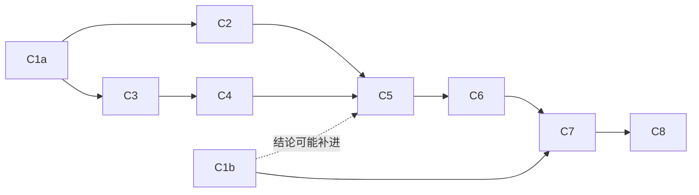

# chat 应用上 Cloudflare — 施工进展

> 要做什么见[功能手册](../features/chat-on-cloudflare.md)；怎么做见[技术方案](../tech/chat-on-cloudflare.md)。术语见 [术语表](../../../terms.md)。

## 当前状态

| 阶段 | 内容 | 状态 |
|---|---|---|
| C0 | 三份文档、术语表（会话对象） | ✅ |
| C1a | **本地可行性实测**（`wrangler dev`，不要账号）：技术方案 §11 的 3、4、5 条 + 一个最小会话对象跑通 agent | ✅ 全部成立（见[实测结果](#实测结果)） |
| C1b | **线上可行性实测**（要 Cloudflare 付费档账号）：技术方案 §11 的 1、2、6 条 | 待做（要账号，挡上线） |
| C2 | `@runko/durable-object`：会话对象 SQLite 的 Kysely 方言 + 运行时装配；持久化一致性用例在 workerd 里全过 | ✅ |
| C3 | 抽共用层 `apps/chat-shared`：Node 版行为不变 | ✅ |
| C4 | `apps/cloudflare-server` 骨架：Worker、静态资源、D1、better-auth、会话列表与建会话 | ✅ |
| C5 | 会话对象：发消息、直播（SSE / WebSocket）、停止、队列、审批与挂起、重启后恢复 | ✅ |
| C6 | 沙盒：本地沙盒、Cloudflare 沙盒（规格、提前唤醒）、GitHub 选仓库 | ✅ 本地验完；真 GitHub App 选私有仓库、推分支要账号，留给真部署验收 |
| C7 | 部署脚本与部署说明、用量提醒 | ✅ 脚本与说明写完、`--dry-run` 走通；在全新账号上真部署要等 C1b |
| C8 | 测试补齐、清理旧注释、代码审查、端到端（`wrangler dev` + 浏览器）、真部署验收 | ✅ 除真部署验收（要人、要账号） |

**顺序**：

- **C1a 最先做**：它证明「这套东西在 workerd 里跑得起来」，过了之后 C2–C6 的开发与测试都能在本地完成。
- **C1b 不挡开发，但挡上线**：它验的三条（长轮会不会被回收、CPU 上限、部署时怎么重启）只有线上才看得到，本地模拟器不回收会话对象、也不限制 CPU。C5 照「重启后恢复 + 定时唤醒」来做（不管 C1b 结论如何都要有），C1b 的结论只决定要不要再加保活手段。**C7（部署）之前必须做完 C1b**。
- C2 与 C3 互不依赖，可以并行。C4 依赖 C3；C5 依赖 C2、C4；C6 依赖 C5；C7、C8 最后。

## 各阶段

### C1a · 本地可行性实测（不要账号）

本机开着 Docker，`wrangler dev` 起一个最小 Worker，逐条验（编号对应[技术方案 §11](../tech/chat-on-cloudflare.md)）：

| # | 要证明什么 | 怎么证明 | 不成立的话 |
|---|---|---|---|
| 3 | better-auth 在 Workers + D1 上能用 | 注册、登录、拿登录态；GitHub 回调走到 better-auth 的回调处理（本地不真连 GitHub） | 换 better-auth 的 D1 原生适配，或者退回自己写登录 |
| 4 | D1 建表 | Kysely 迁移导出 SQL，`wrangler d1 migrations apply --local` | 手写 SQL 迁移（不推荐） |
| 5 | 会话对象里调沙盒、克隆时带环境变量 | 起一个 `standard-1` 沙盒（本机 Docker），带环境变量跑一条 `git clone`（公开仓库） | 令牌先写进沙盒里一个临时文件，克隆时用凭据助手读 |
| — | 最小会话对象跑通 agent | 会话对象里 `createAgentRuntime`（演示模型、本地沙盒、内存持久化即可），发一条消息、SSE 收到直播 | 方案不成立，回到技术方案重新选 |
| — | 本地模拟器会不会回收会话对象 | 跑一个几分钟的任务，期间不连浏览器，看日志 | 只用来解释本地与线上的差别，不影响结论 |

- **产出**：每条一行结论，回填到下面的「实测结果」；不成立的同步改技术方案。

### C1b · 线上可行性实测（要付费档账号）

部署一个最小 Worker 到测试账号上：

| # | 要证明什么 | 怎么证明 | 不成立的话 |
|---|---|---|---|
| 1 | 长轮期间会话对象不被回收 | 会话对象里跑一个 30 分钟、每隔几秒发一次网络请求的任务，期间没有任何浏览器连着；看能不能跑完 | 加保活手段，或者接受「定时唤醒 + 断了就补已中断」（技术方案 §4.2） |
| 2 | 会话对象 CPU 不撞上限 | 同上，看计费面板与日志里的 CPU 用量 | 在配置里把 CPU 上限调高 |
| 6 | 部署时会话对象怎么重启 | 跑着一轮时部署新版本，看这一轮与连着的直播 | 只影响用户提示，写进已知限制 |

- 顺便记下线上真实数字：沙盒冷启动多少秒、会话对象首次唤醒多少毫秒。
- **产出**：回填「实测结果」；结论补进技术方案 §4.2、§11。

### C2 · `@runko/durable-object`

- **文件**：`packages/durable-object/`（新包）：Kysely 方言（编译用 SQLite 编译器，执行交给 `ctx.storage.sql.exec`）、`createDurableObjectRuntime(ctx, opts)` 装配；README；changeset（minor，新包）。
- **产出**：`@runko/conformance` 的持久化用例在 `@cloudflare/vitest-pool-workers` 里全过。

### C3 · 共用层 `apps/chat-shared`

- **文件**：新包 `apps/chat-shared`；从 `apps/node-server` 挪出技术方案 §7 那张表里的模块；GitHub App 的 JWT 改用 WebCrypto；定义「会话后端」接口，Node 版实现它。
- **产出**：`apps/node-server` 全部测试与集群端到端四套照旧全绿（行为不变是这一步唯一的验收）。

### C4 · Worker 骨架

- **文件**：新包 `apps/cloudflare-server`：`wrangler.jsonc`（D1、会话对象、沙盒绑定，静态资源单页回退）、Worker 入口（共用路由 + Cloudflare 版会话后端）、D1 迁移。
- **产出**：`wrangler dev` 起来能注册、登录、建会话（先用本地沙盒）、列会话。

### C5 · 会话对象

- **文件**：`apps/cloudflare-server/src/conversation-object.ts` 等。
- **产出**：技术方案 §3、§4 的全部行为：发消息、SSE 与 WebSocket 直播、断线续传、停止、排队与插话、审批、挂起（内存窗口调短）与恢复、重启后恢复（定时唤醒）、会话列表状态回写。

### C6 · 沙盒

- **文件**：本地沙盒（快照存会话对象 SQLite）；Cloudflare 沙盒接入（`standard-1`、打开会话时提前唤醒、闲置休眠）；GitHub 选仓库（克隆绕过网关带环境变量、令牌文件、凭据助手）。
- **产出**：功能手册 §5 第 3 条。

### C7 · 部署

- **文件**：部署脚本（建 D1 → 迁移 → 打包前端 → `wrangler deploy`）；`apps/cloudflare-server/README.md` 部署说明（含开通付费档、填密钥、设用量提醒）。
- **产出**：功能手册 §5 第 1 条，在一个全新账号上走通。

### C8 · 收尾

- 测试补齐（技术方案 §10）、清理旧注释、一轮高强度代码审查并修完、全仓检查、`wrangler dev` + 浏览器端到端、真部署按功能手册 §5 逐条验收（要人来做）。

## 实测结果

### C1a · 本地（2026-11-07，wrangler 4.112、workerd 1.20260714、本机 Docker 为 OrbStack）

| # | 结论 | 怎么验的 |
|---|---|---|
| 3 | ✅ better-auth 在 Workers + D1 上能用 | 自己写的 D1 Kysely 方言接 better-auth（`{ db, type: 'sqlite' }`），注册、登录、拿登录态都通；限流存 D1。GitHub 回调没有真连 GitHub |
| 4 | ✅ D1 建表 | better-auth 的 `getMigrations` 与应用的 Kysely 迁移在内存 SQLite 上跑一遍、导出成 `migrations/0001_init.sql`，`wrangler d1 migrations apply --local` 建表成功；测试里用 `applyD1Migrations` 跑同一份 |
| 5 | ✅ 会话对象里调沙盒、克隆时带环境变量 | 一次性测试 Worker 里起 `standard-1` 沙盒：`exec(cmd, { env: { GH_TOKEN } })` 拿得到环境变量、命令行里没有令牌；克隆公开仓库 1.8 秒；共用层完整初始化（写令牌文件、凭据助手、改回 origin、切分支、装 skill）连冷启动 23 秒 |
| — | ✅ 会话对象跑通 agent | 不是最小版，直接是整个 chat 应用：演示模型、本地沙盒，发消息、SSE 与 WebSocket 直播、排队、插话、停止、审批、提问（挂起后恢复）都通 |
| — | 本地模拟器不回收会话对象 | 一轮跑了约 3 分钟，期间没有任何连接，日志里一直在跑、正常收尾（见下） |

几条顺带发现的：

- **本地 workerd 只认到 2026-07-21 的兼容日期**，`compatibility_date` 写更新的会起不来，所以定在 `2026-07-01`。
- **`just-bash` 的浏览器构建缺 `unsafeBytesFromLatin1`**，Worker 打包时报错。`@runko/just-bash` 改成自己转字节串（带 changeset）。
- **框架的「一轮收尾了」通知排在放手之前**，那一刻读活动状态还是「在跑」，列表状态副本于是停在「在跑」。改成收尾后隔一小会儿复查再回写（技术方案 §4.5）。
- **跨 RPC 的 cancel 是懒的**：对象那一侧要到下一次往流里写才发现对面走了，所以直播流加了保活空行（`@runko/durable-object` 的 `framesToStream`）。
- **`wrangler dev` 每断一条 WebSocket 打一行 `Uncaught Error: Network connection lost.`**：一个只做 accept / send / close 的最小 Worker 也一样，是本地模拟器的噪音，不是应用的错。
- **`evictDurableObject()` 测不到中断**：它会等对象里的定时器走完（演示模型一直在设定时器），这一轮就跑完了。测重启用 `abortAllDurableObjects()`。

### C1b · 线上

（要付费档账号，未做。）

## 验证方案

| 验什么 | 怎么跑 | 实际结果（2026-11-07） |
|---|---|---|
| 框架包 | `pnpm --filter @runko/durable-object test` | 98 条全过（workerd 里跑，含 `@runko/conformance` 持久化用例） |
| Node 版行为不变 | `pnpm --filter @runko-chat/node-server test` | 全过 |
| Cloudflare 版 | `pnpm --filter @runko-chat/cloudflare-server test` | 先查 D1 迁移没有没导出的改动，再在 workerd 里跑 35 条：D1 方言、快照分块、能力开关、路由全流程（注册、建会话、点名没开的沙盒 400、发消息、排队、删排队、停止、审批、提问、别人的会话 404、WebSocket）、重启后靠定时唤醒恢复（身后有排队的接着跑；没有的，列表状态也回写成「没在跑」） |
| Cloudflare 沙盒 | `wrangler dev` + 本机 Docker 起一次性测试 Worker 直接调 provider | 见上面 C1a 第 5 条 |
| 端到端 | `pnpm cf:dev`，agent-browser 走一遍 | 注册 → 首页 → 建会话 → `run:` 命令（bash 卡片）→ 刷新回放 → 长回复中途刷新续上 → 跑完；集群控制台入口不出现 |
| 部署脚本 | `pnpm cf:deploy --dry-run` | 编译依赖、打包前端、`wrangler deploy --dry-run`（含构建沙盒镜像）都过；建 D1、远程迁移、填密钥三步只打印 |
| 全仓 | `pnpm -r build`、`pnpm -r typecheck`、`pnpm -r test`、`pnpm lint`、`pnpm check:doc-links`、`pnpm docs:check`、`pnpm docs:build` | 都过。唯一的例外是 `apps/web` 的 59 条测试，与本期无关、早就挂着：Node 26 下 `window.localStorage` 是 undefined，把本期改动拿掉也是同样 59 条 |
| 真部署 | 全新账号上 `pnpm cf:deploy`，按[功能手册 §5](../features/chat-on-cloudflare.md) 逐条走 | 未做：要人、要付费档账号 |

## 变更记录

| 日期 | 变更 |
|---|---|
| 2026-10-01 | C0：三份文档、术语表一条（会话对象）。决策：Cloudflare 付费档（否决免费档、Vercel、自己的虚拟机，只从用户体验比，见功能手册附录 A）；一个会话一个会话对象，框架的表复用 `@runko/persist-kysely`；跨会话的数据放 D1；先抽共用层再做 Cloudflare 版；本期不做推送通知与部署时无感续跑 |
| 2026-10-01 | C1 拆成 C1a（本地，`wrangler dev`）与 C1b（线上，付费档账号）：本地模拟器不回收会话对象、也不限制 CPU，长轮、CPU、部署重启这三条只有线上看得到。C1b 不挡 C2–C6 的开发，挡 C7 上线 |
| 2026-11-07 | C1a、C2–C8 做完（真部署与 C1b 除外，要账号）。和技术方案初稿不同的几处：归属仲裁用 `durableObjectArbitration`（起轮标记落对象 SQLite，否则重启后扫不出没收尾的轮），不是进程内版；方言的影响行数查 `changes()`，不用 `rowsWritten`；列表状态单独一张 `conversation_live`，不是 `conversations` 上的一列；首页的笔记示例路由挪进共用层，两边都挂。顺手：`@runko/just-bash` 不再依赖 just-bash 浏览器构建里没有的导出（patch）；根目录加 `cf:dev`、`cf:deploy`，`chat:server`、`chat:bootstrap` 先编译共用层 |
| 2026-11-07 | 代码审查后的修正：D1 迁移改成只追加（重放已有文件、导出增量，迁移记录表也建在 D1；`conversation_live` 也改成一段 Kysely 迁移，改它同样能导出增量）；会话对象把会话 id 记进对象存储，重启后补「已中断」时也回写列表状态（之前身后没排队的消息就一直显示「在跑」）；列表读 D1 时 `IN` 按 100 个一批（D1 的参数上限）；建会话点名这台服务端没开的沙盒回 400（两边都是）；部署脚本把 `BETTER_AUTH_SECRET` 随第一次部署一起上传，不再部署之后才补（认 wrangler 4.112 的「Worker 不存在」文案；Ctrl-C 也会删掉临时密钥文件）；本地沙盒快照太大存不下时记 error，并改正提示文案；快照切块在块大小为 1 时不再原地打转；Cloudflare 沙盒的说明写明休眠会清空磁盘；技术方案 §12 补「一条账本消息最多 2 MB」 |
